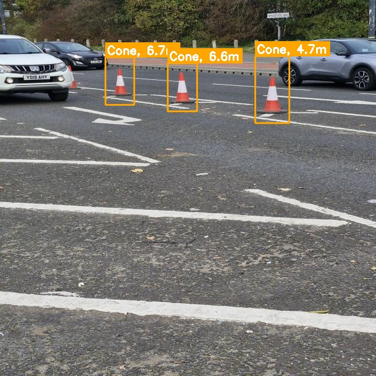
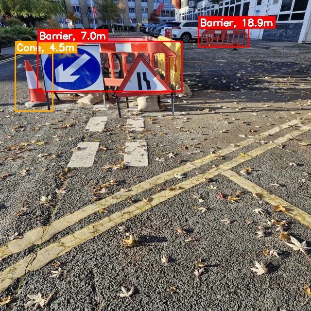
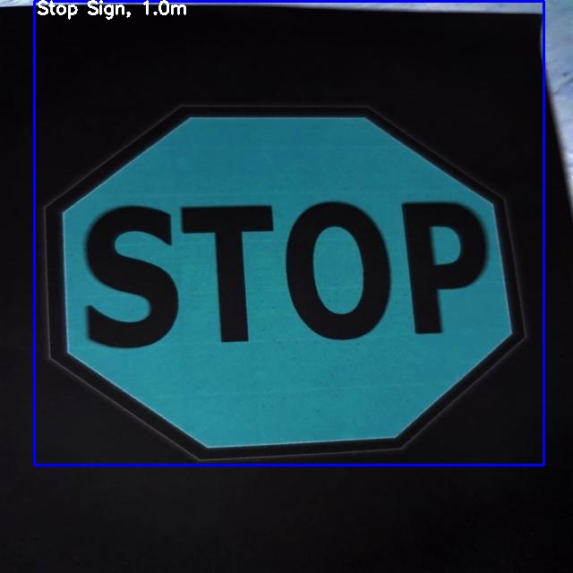
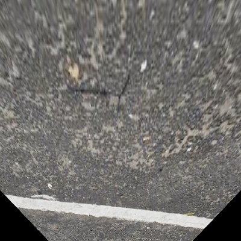

# Object Detection and Monocular Distance Estimation for Robotics Navigation

**Candidate:** Rishita Ramesh Kadam

## Overview
An end-to-end, edge-optimized perception pipeline designed for autonomous mobile robot navigation. The system detects navigation-critical obstacles (**Traffic Cones**, **Barriers**, and **Stop Signs**), estimates their metric distance from the camera via calibrated pinhole geometry, projects detections onto a **Birds-Eye View (BEV)** navigation plane, and benchmarks **FP32 vs. INT8** quantization for resource-constrained edge hardware.

---

## Visual Results (Distance Annotation and Birds-Eye View)

| Traffic Cone Detection and Distance | Barrier and Multi-Object Detection |
| :---: | :---: |
|  |  |

| Stop Sign Detection and Distance | Birds-Eye View (BEV) Homography Transform |
| :---: | :---: |
|  |  |

---

## System Architecture and Pipeline
    Camera Frame -> YOLOv11n / INT8 Detector -> Bounding Boxes (x1, y1, x2, y2)
                                                       |
                     +---------------------------------+---------------------------------+
                     v                                                                   v
       Monocular Pinhole Depth Estimator                                   Planar Homography Transform
         Z = (f_px * H_real) / h_pixel                                      cv2.getPerspectiveTransform
                     |                                                                   |
                     v                                                                   v
       Annotated Frame (Cone, 1.5m)                                        Top-Down 2D Navigation Grid

### Repository Structure
* `configs/config.yaml` - Camera intrinsics (`f = 720 px`), nominal physical object heights, and NMS thresholds
* `src/merge_data.py` - Multi-dataset schema alignment and class-balanced merging
* `src/train.py` - Transfer learning fine-tuning pipeline
* `src/distance_estimator.py` - Geometric monocular depth estimator and Birds-Eye View (BEV) homography warper
* `src/infer.py` - End-to-end inference script outputting `<Class>, <Distance>m` annotations
* `src/benchmark.py` - Automated CPU vs. GPU FPS, latency, and model footprint profiler
* `weights/` - Fine-tuned PyTorch (`best.pt`) and exported ONNX (`best.onnx`) weights
* `outputs/` - Sample annotated inference frames and BEV perspective warps

---

## Quantitative Results

### 1. Detection Accuracy (Validation Set - 218 Images)
| Class | Images | Instances | Precision | Recall | mAP@50 | mAP@50-95 |
| :--- | :---: | :---: | :---: | :---: | :---: | :---: |
| **All Classes** | 218 | 261 | 0.831 | 0.866 | **0.862** | 0.697 |
| **Cone** | 60 | 102 | 0.894 | 0.931 | **0.954** | 0.710 |
| **Barrier** | 8 | 9 | 0.602 | 0.667 | **0.636** | 0.445 |
| **Stop Sign** | 150 | 150 | 0.998 | 1.000 | **0.995** | 0.936 |

### 2. Edge Optimization and Runtime Benchmark (Before vs. After)
| Model Variant | Precision | Model Size | mAP@50 | CPU FPS | GPU FPS | Key Takeaway |
| :--- | :---: | :---: | :---: | :---: | :---: | :--- |
| **PyTorch (`.pt`) - Baseline** | FP32 | 6.20 MB | 0.862 | 8.1 | **104.4** | High GPU throughput; heavy for CPU edge |
| **ONNX (`.onnx`)** | FP32 | 12.18 MB | **0.876** | 8.4 | N/A (CPU EP) | Cross-platform runtime portability |
| **OpenVINO - Quantized** | **INT8** | **3.56 MB** | 0.864 | **13.8** | N/A (CPU Edge) | **-42.6% size**, **+70.4% CPU FPS**, zero mAP drop |

---

## Engineering Analysis and Robotics Deployment Notes

| Engineering Focus | Observation & Quantitative Impact | Robotics Deployment Action |
| :--- | :--- | :--- |
| **Edge Quantization Trade-Off** | OpenVINO INT8 quantization reduced model footprint by **42.6%** (`6.20 MB` -> `3.56 MB`) and increased CPU speed by **1.7x** (`8.1` -> `13.8 FPS`) with zero accuracy drop (`0.864` vs. `0.862 mAP@50`). | Ready for real-time execution on CPU-only embedded robot controllers without discrete GPUs. |
| **Class Imbalance Mitigation** | `cone` (`0.954 mAP@50`) and `stop_sign` (`0.995 mAP@50`) achieved high precision and recall, while `barrier` (`0.636 mAP@50`) was limited by validation sample count (`9` instances). | Apply targeted copy-paste barrier augmentation and class-balanced sampling in the next training cycle. |
| **Geometric Depth Bounds** | Pinhole depth (`Z = (f * H_real) / h_pixel`) relies on unoccluded nominal object heights (`Cone = 0.75 m`, `Barrier = 1.00 m`, `Stop Sign = 0.75 m`). | Fuse monocular detections with 2D LiDAR scans or stereo disparity in ROS 2 to bound depth error during partial occlusion. |

---

## Quickstart
1. **Install dependencies:** `pip install -r requirements.txt`
2. **Run detection and metric distance annotation:** `python src/infer.py --weights weights/best.pt --source outputs/ --output outputs/`
3. **Run CPU vs. GPU FPS and quantization benchmark:** `python src/benchmark.py --weights weights/best.pt`

---

## Contact
* **Name:** Rishita Ramesh Kadam
* **Phone:** 8618592259
* **Email:** kadamrishita3@gmail.com
